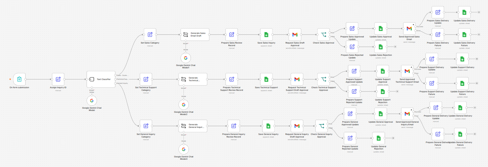
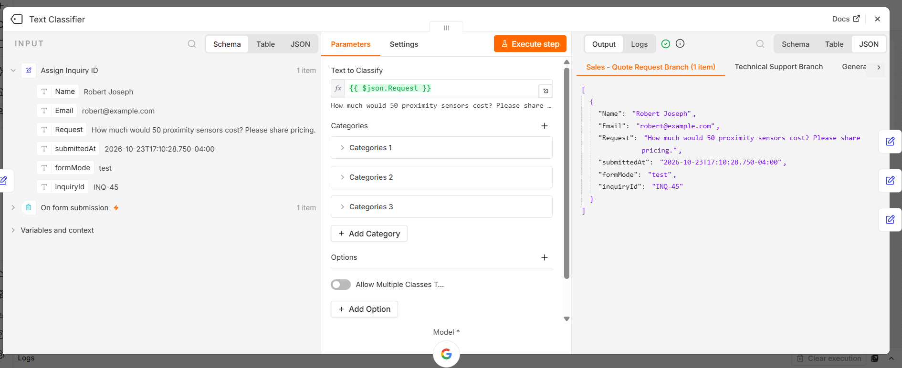
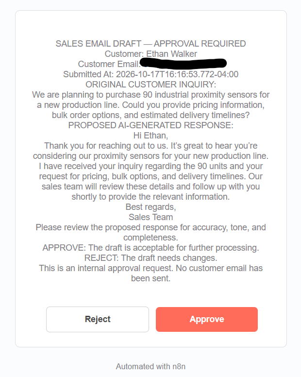
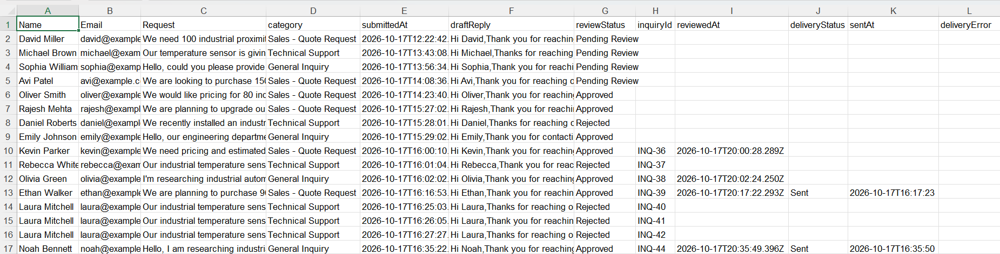
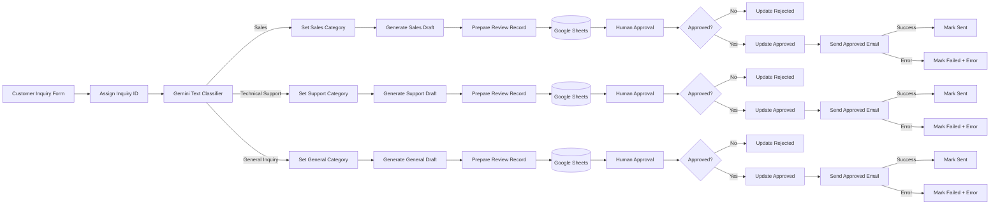

# AI-Powered Business Inquiry Automation

An end-to-end **AI-assisted customer inquiry workflow** built with **n8n, Google Gemini, Gmail, and Google Sheets**.

The system captures incoming inquiries, assigns a unique inquiry ID, uses Gemini to classify business intent, generates a category-specific response draft, stores the record, requests human approval, sends only approved responses, and records delivery success or failure.

> **Portfolio project:** All customer examples in this repository are fictional. The public workflow export is sanitized and contains no production credentials, API keys, private spreadsheet IDs, or real customer records.

## Demo

### Complete workflow



The workflow has three parallel routes: **Sales**, **Technical Support**, and **General Inquiry**. Each route includes AI drafting, persistent tracking, a human approval gate, approved-only email delivery, and success/failure tracking.

### Gemini semantic classification



The example request asks, *“How much would 50 proximity sensors cost? Please share pricing.”* The request does not use the word **quote**, but Gemini correctly routes it to **Sales - Quote Request**, demonstrating semantic intent classification rather than keyword-only matching.

### Human approval gate



The generated draft is presented to a reviewer with **Approve** and **Reject** controls. The workflow pauses until a human decision is made. Rejected drafts never enter the outbound customer-email path.

### Inquiry tracking



Google Sheets is used as a lightweight tracking layer for inquiry details, classification, generated drafts, review status, inquiry IDs, timestamps, and delivery state.

## What this project demonstrates

- Workflow automation with n8n
- Google Gemini integration
- AI-based semantic text classification
- Category-specific LLM prompt design
- Guardrails against fabricated business information
- Human-in-the-loop approval
- Conditional routing and branching
- Gmail integration
- Google Sheets create/update operations
- Stable inquiry tracking with unique IDs
- Approval/rejection timestamps
- Approved-only outbound delivery
- Delivery success and failure tracking
- Safe separation between AI generation and external actions

## End-to-end flow



## Inquiry categories

| Category | Typical intent |
|---|---|
| **Sales - Quote Request** | Pricing, quotations, purchasing, bulk orders, discounts, availability |
| **Technical Support** | Installation issues, troubleshooting, malfunction, errors, repairs, compatibility |
| **General Inquiry** | Product information, catalogues, documentation, specifications, general questions |

The classifier is configured to select one primary category for each inquiry.

## Human-in-the-loop design

The AI model does **not** directly send customer messages.

1. Gemini drafts a response.
2. The inquiry and draft are stored.
3. An internal approval request is sent to a reviewer.
4. The workflow waits for an **Approve** or **Reject** decision.
5. Rejected drafts stop and are recorded as `Rejected`.
6. Approved drafts continue to the outbound email node.
7. Delivery success or failure is recorded against the same inquiry.

This creates a clear control boundary between **AI-generated content** and **external communication**.

## Prompt guardrails

The category-specific prompts instruct the model not to fabricate information such as:

- prices or discounts
- stock availability
- delivery dates
- product specifications
- warranty terms
- company policies
- troubleshooting outcomes
- actions that have not actually occurred

For Technical Support, the draft can request useful details such as model numbers or error information, but should not pretend a diagnosis has already been completed.

## Tracking schema

Recommended Google Sheets columns:

| Field | Purpose |
|---|---|
| `Name` | Customer name |
| `Email` | Customer email |
| `Request` | Original inquiry |
| `category` | AI-assigned category |
| `submittedAt` | Form submission timestamp |
| `draftReply` | Gemini-generated draft |
| `reviewStatus` | Pending Review / Approved / Rejected |
| `inquiryId` | Stable unique identifier |
| `reviewedAt` | Approval/rejection timestamp |
| `deliveryStatus` | Sent / Failed |
| `sentAt` | Successful-send timestamp |
| `deliveryError` | Captured error when delivery fails |

## Unique inquiry IDs

Every form execution receives an identifier such as:

```text
INQ-45
```

Later approval and delivery updates match the record using `inquiryId`, rather than relying on a timestamp as the primary key.

## Delivery error handling

Outbound Gmail nodes use separate success and error paths.

**Success path**

```text
deliveryStatus = Sent
sentAt = <timestamp>
```

**Failure path**

```text
deliveryStatus = Failed
deliveryError = <captured error>
```

This ensures a failed send is visible in the tracking record rather than silently disappearing.

## Testing performed

The workflow was tested across:

- Sales → Approve
- Sales → Reject
- Technical Support → Approve
- Technical Support → Reject
- General Inquiry → Approve
- General Inquiry → Reject
- approved-message delivery
- rejected-message no-send behavior
- unique inquiry ID updates
- review timestamps
- delivery success tracking
- delivery failure paths

See [`samples/test-cases.md`](samples/test-cases.md) for representative fictional inputs.

## Repository structure

```text
ai-business-inquiry-automation/
├── README.md
├── SECURITY.md
├── .gitignore
├── workflow/
│   └── ai_business_inquiry_automation.json
├── docs/
│   ├── workflow-overview.png
│   ├── classifier-result.png
│   ├── approval-email.png
│   ├── inquiry-tracker.png
│   ├── architecture.md
│   ├── setup-guide.md
│   ├── implementation-notes.md
│   └── portfolio-wording.md
└── samples/
    └── test-cases.md
```

## Setup

See [`docs/setup-guide.md`](docs/setup-guide.md) for import and configuration instructions.

At a high level:

1. Import the sanitized n8n workflow JSON.
2. Connect Google Gemini credentials or an available n8n AI gateway.
3. Connect Google Sheets credentials.
4. Create the `Inquiries` worksheet and required columns.
5. Connect Gmail credentials.
6. Replace placeholder reviewer/test recipient addresses.
7. Point every Google Sheets node to your own spreadsheet.
8. Test all approval/rejection paths using inboxes you control.

## Security

The public JSON is sanitized. Do not commit:

- API keys
- OAuth tokens
- n8n credential exports
- production spreadsheet IDs
- personal reviewer addresses
- webhook secrets
- real customer data

See [`SECURITY.md`](SECURITY.md).

## Production considerations

This is a portfolio implementation. A larger production deployment would normally add:

- a CRM or relational database instead of Google Sheets
- role-based approval routing
- retry/backoff for transient API failures
- idempotency controls
- centralized logging and alerting
- model/prompt versioning
- classifier evaluation datasets
- privacy and retention controls
- service-level timers and escalation rules

## Possible next extensions

- MCP-based product-information lookup
- Power Automate implementation of a comparable workflow
- CRM integration
- reporting dashboard for volume, category mix, approval rate, turnaround time, and delivery failures

## Author

**Avikumar Patel** 
