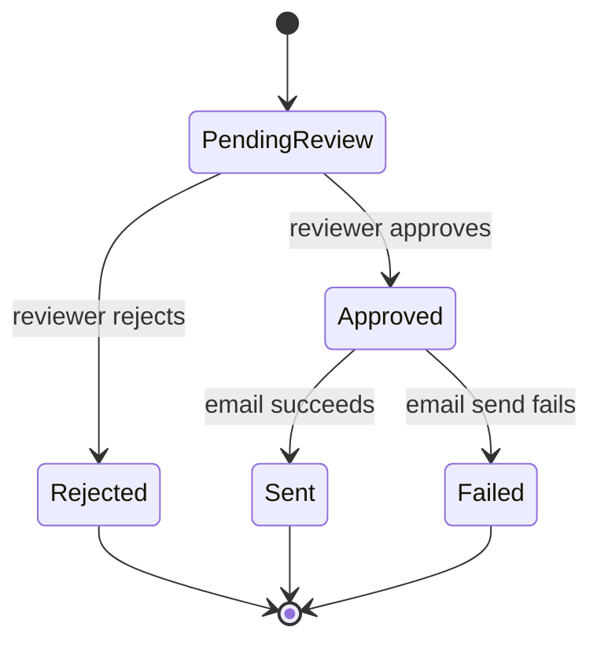

# Architecture

## System components

- **n8n Form Trigger** — captures customer name, email, and inquiry.
- **Assign Inquiry ID** — adds a stable ID using the n8n execution identifier.
- **Google Gemini Text Classifier** — performs semantic intent classification.
- **Category-specific Gemini chains** — generate guarded response drafts.
- **Google Sheets** — acts as a lightweight inquiry/audit tracker.
- **Gmail Send and Wait** — implements internal human approval.
- **IF nodes** — separate approved and rejected outcomes.
- **Gmail outbound nodes** — send only approved drafts.
- **Success/error branches** — record delivery outcome.

## State model

## Important control boundary

The AI draft-generation step and outbound-email step are deliberately separated by a human approval gate. This prevents a generated response from directly causing an external communication without review.
